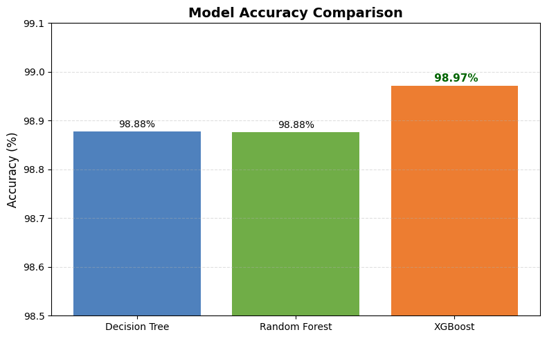

# Healthcare IoMT Cyberattack Detection Using Machine Learning

A machine learning cybersecurity project that detects and classifies cyberattacks targeting Internet of Medical Things (IoMT) environments using network traffic from the MedSec-25 dataset.

This project compares Decision Tree, Random Forest, and XGBoost classifiers across five network traffic classes and analyzes which network features contribute most to attack detection.

## 🔍 Project Overview

Healthcare environments increasingly rely on connected medical and IoT devices, making network monitoring and attack detection an important cybersecurity challenge.

The goal of this project was to build a multiclass machine learning system capable of distinguishing benign network traffic from several categories of cyberattacks targeting an IoMT environment.

The project evaluates three supervised machine learning algorithms:

- Decision Tree
- Random Forest
- XGBoost

The models classify network traffic into five categories:

- Benign
- Exfiltration
- Initial Access
- Lateral Movement
- Reconnaissance

## 📊 Dataset

The project uses the **MedSec-25 Healthcare IoMT dataset**.

The loaded dataset contains:

| Dataset Property | Value |
|---|---:|
| Network Traffic Records | 554,534 |
| Original Features / Columns | 84 |
| Features Used for Modeling | 79 |
| Target Classes | 5 |

The dataset contains network-flow characteristics including ports, protocol information, packet statistics, flow duration, TCP flags, packet lengths, inter-arrival times, and other traffic measurements.

### Class Distribution

| Traffic Class | Samples |
|---|---:|
| Reconnaissance | 401,683 |
| Initial Access | 102,090 |
| Exfiltration | 25,915 |
| Lateral Movement | 12,498 |
| Benign | 12,348 |

The class distribution is highly imbalanced, with Reconnaissance representing the majority of observations.

## 🛠️ Technologies Used

- Python
- Google Colab
- Pandas
- Scikit-learn
- XGBoost
- Matplotlib
- Jupyter Notebook
- Git / GitHub

## ⚙️ Methodology

### 1. Dataset Exploration

The dataset was first explored to understand:

- Dataset dimensions
- Available network features
- Data types
- Missing values
- Target labels
- Class distribution

The dataset contained **554,534 records and 84 columns**, with no missing values identified during the initial analysis.

### 2. Feature Preparation

Several identifier and non-predictive columns were removed before model training:

- `Flow ID`
- `Src IP`
- `Dst IP`
- `Timestamp`
- `Label`

After removing these fields, the feature matrix contained **79 network traffic features**.

The target variable was stored separately for classification.

### 3. Target Encoding

The five traffic labels were converted into numerical values using Scikit-learn's `LabelEncoder`.

The resulting classes were:

```text
0 = Benign
1 = Exfiltration
2 = Initial Access
3 = Lateral Movement
4 = Reconnaissance
```

### 4. Train/Test Split

The dataset was divided using a stratified train/test split:

- **80% Training**
- **20% Testing**
- **Random State:** 42
- **Stratification:** Enabled

This produced:

| Split | Samples |
|---|---:|
| Training | 443,627 |
| Testing | 110,907 |

Stratification was used to preserve the original class distribution across the training and testing datasets.

## 🤖 Machine Learning Models

### Decision Tree

A Decision Tree classifier was trained as the first model.

**Accuracy: 98.88%**

The model achieved strong performance across most attack categories.

Notable observations:

- Initial Access achieved an F1-score of **1.00**
- Reconnaissance achieved an F1-score of **0.99**
- Benign traffic achieved an F1-score of **0.98**
- Exfiltration achieved an F1-score of **0.94**
- Lateral Movement was the most difficult class, with an F1-score of **0.85**

### Random Forest

A Random Forest classifier with **100 estimators** was trained to provide an ensemble-based comparison.

**Accuracy: 98.88%**

Random Forest improved recall for Lateral Movement compared with the Decision Tree while maintaining strong overall performance.

Notable class F1-scores included:

- Initial Access: **1.00**
- Reconnaissance: **0.99**
- Benign: **0.98**
- Exfiltration: **0.94**
- Lateral Movement: **0.86**

### XGBoost

An XGBoost multiclass classifier was also trained using 100 estimators.

**Accuracy: 98.97%**

XGBoost achieved the highest overall accuracy of the three evaluated models.

Notable class F1-scores included:

- Initial Access: **1.00**
- Reconnaissance: **0.99**
- Benign: **0.98**
- Exfiltration: **0.95**
- Lateral Movement: **0.85**

## 📈 Model Comparison

| Model | Accuracy |
|---|---:|
| Decision Tree | 98.88% |
| Random Forest | 98.88% |
| **XGBoost** | **98.97%** |

All three models achieved high overall accuracy.

**XGBoost produced the highest overall accuracy and macro F1-score and was selected as the best-performing model in this experiment.**

## 🔎 Feature Importance Analysis

Feature importance was analyzed using the trained XGBoost model to determine which network characteristics contributed most to cyberattack classification.

The ten most influential features were:

| Rank | Feature | Importance |
|---:|---|---:|
| 1 | Bwd Header Len | 0.267 |
| 2 | Fwd Header Len | 0.178 |
| 3 | SYN Flag Cnt | 0.164 |
| 4 | Dst Port | 0.051 |
| 5 | Protocol | 0.049 |
| 6 | Bwd Pkt Len Std | 0.039 |
| 7 | Bwd Pkts/s | 0.029 |
| 8 | Flow Duration | 0.028 |
| 9 | Pkt Len Min | 0.022 |
| 10 | Bwd IAT Min | 0.018 |

The analysis suggests that packet-header characteristics, TCP SYN activity, destination ports, protocol information, and packet timing behavior were particularly influential in the XGBoost classifier.

## 📉 Model Evaluation

The notebook includes visualizations for:

- Attack class distribution
- Decision Tree confusion matrix
- Random Forest confusion matrix
- XGBoost confusion matrix
- Model accuracy comparison
- XGBoost feature importance

Confusion matrices were used to analyze which traffic classes were most frequently confused by each classifier.

One consistent challenge was identifying **Lateral Movement**, which produced lower F1-scores than the other attack categories.

## 🔐 Cybersecurity Relevance

Machine learning can assist security teams in analyzing large volumes of network telemetry and identifying patterns associated with malicious activity.

In a healthcare IoMT environment, this can support detection of behaviors associated with:

- Reconnaissance
- Initial access
- Lateral movement
- Data exfiltration

This project demonstrates practical experience with:

- Network traffic analysis
- Cyberattack classification
- Intrusion detection
- Machine learning for cybersecurity
- Multiclass classification
- Security dataset preprocessing
- Model comparison
- Feature importance analysis
- Security-focused model evaluation

## 📁 Repository Structure

```text
healthcare-iomt-attack-detection/
│
├── Healthcare_IoMT_Cyberattack_Detection.ipynb
└── README.md
```

## ▶️ Running the Project

The implementation is contained in:

```text
Healthcare_IoMT_Cyberattack_Detection.ipynb
```

The notebook can be viewed directly on GitHub or opened in Google Colab.

The notebook contains the complete workflow:

```text
Dataset Loading
      ↓
Dataset Exploration
      ↓
Feature Preparation
      ↓
Target Encoding
      ↓
Stratified Train/Test Split
      ↓
Decision Tree
      ↓
Random Forest
      ↓
XGBoost
      ↓
Model Evaluation
      ↓
Model Comparison
      ↓
Feature Importance Analysis
```

> **Dataset note:** The MedSec-25 dataset is not included directly in this repository. The notebook expects the dataset to be available separately and the dataset path may need to be updated before running the notebook.

## 🎯 Key Findings

- All three machine learning models achieved approximately **98.9% accuracy**
- **XGBoost achieved the highest overall accuracy at 98.97%**
- Initial Access was classified particularly well across the evaluated models
- Lateral Movement was the most challenging attack category
- Network header characteristics and SYN flag activity were among the most influential XGBoost features
- Feature importance analysis provided additional insight beyond overall model accuracy
- Class imbalance is an important consideration when interpreting the high aggregate accuracy

## 🎓 Project Context

This project was developed as a senior cybersecurity capstone project at the University of South Carolina Upstate.

The project explores the application of machine learning to cyberattack detection in healthcare Internet of Medical Things environments.

## 👤 Author

**Alani Hodge**  
Cybersecurity Student | Security Operations | Threat Detection

[LinkedIn](https://www.linkedin.com/in/alani-hodge) | [GitHub](https://github.com/lghcyber)
